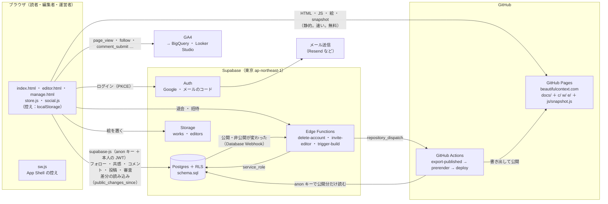

# Beautiful Context — バックエンドの設計（Supabase）

> 状態：**設計だけ**。プロジェクトはまだ作っていない。`docs/` は一行も変えていない。
> 書いた人の前提：エンジニアは一人。だから「自分でサーバーを持たない・夜中に起こされない」ことを最優先にした。

| ファイル | 中身 |
|---|---|
| `backend/README.md` | これ。全体の形・表・権限・流れ・引っ越し・段階・費用・危険 |
| `backend/schema.sql` | Supabase にそのまま流せる migration（表・RLS・トリガー・取り込み関数・Storage・集計ビュー） |
| `backend/client-plan.md` | `docs/js/store.js` と `docs/js/social.js` を localStorage から Supabase に切り替える手順（関数ごと） |

---

## 0. 三行で

1. **読むものは静的のまま、書くものだけ Supabase。** 公開中のコンテクストはビルドのときに Supabase から書き出して GitHub Pages に置く（`c/<slug>/` の静的ページと、`seed.js` と同じ形の `snapshot.js`）。読者が開いても Supabase にはほとんど触れない。
2. **Supabase は Postgres ＋ Auth ＋ Storage ＋ RLS だけを使う。** 守りは RLS とトリガーに置き、ブラウザは anon キー（publishable key）だけを持つ。Edge Function は「アカウント削除」「編集者の招待」「ビルドの合図」の三つから始める（第3段階で「お知らせのメール」を足す）。
3. **東京リージョンの Free で作り、公開の日に Pro（月 $25）へ。** Pro にする一番の理由は、毎日のバックアップと、使われない週に止められないこと。

---

## 1. 全体の形



端末で見るとき（Mermaid が出ない場所）の略図：

```
 読者のブラウザ ──(静的：HTML / snapshot.js / 絵)──▶ GitHub Pages ◀──(書き出し)── GitHub Actions
      │                                                                          ▲      │
      ├─(ログイン)────────────▶ Supabase Auth ──▶ メール送信                       │      │ anon キーで
      ├─(書く・自分の分を読む)──▶ Supabase Postgres + RLS ──(Webhook)─▶ Edge Function ┘      │ 公開分を読む
      ├─(絵を置く)────────────▶ Supabase Storage                       ◀───────────────────┘
      └─(イベント)────────────▶ GA4 ──▶ BigQuery ──▶ Looker Studio（先生の分析）
```

### なぜ「読むものは静的」にするのか

| 理由 | 中身 |
|---|---|
| SEO・LLMO | いまの `c/<slug>/`・`w/<slug>/`・`e/<id>/` の静的ページと `sitemap.xml` をそのまま保てる。検索エンジンと生成AIは JS を待たずに本文を読める |
| 速さ | iPhone のホーム画面から開いたとき、ネットを待たずに描く仕組み（`sw.js`）が今のまま効く |
| 費用 | Free の転送量は月 5GB。読者が開くたびに 1,250 本を Supabase から読むと、すぐ超える。静的に置けば GitHub Pages が配る |
| 倒れにくさ | Supabase が止まっても、サイトは読める（書くことだけができなくなる） |

ビルドとビルドのあいだに公開・削除されたものは、ブラウザが `public_changes_since()` で差分だけを取りに行って埋める（5 章）。

---

## 2. 表の一覧

`schema.sql` に全部ある。段階（1〜3）は「画面から使い始める時期」で、表そのものは最初に全部作ってよい。

| 表 | 役目 | いまのどこに当たるか | 段階 |
|---|---|---|---|
| `profiles` | 読者のアカウント。表示名・役割（reader / editor / operator）・利用停止 | `social.js` の `me` | 1 |
| `editors` | 編集者のプロフィール。`id` は URL の `e/<id>/` | `seed.js` の `BC_EDITORS`、`store.js` の `authors`（hidden） | 1 |
| `editor_stats` | 編集者のフォロワー数（トリガーだけが書く） | `render.js` の `ed.followers` | 1 |
| `editor_invites` | 外部の編集者の招待。招いたメールで入ると編集者になる | なし | 2 |
| `editor_picks` | 編集者がほかの人の区間から選んだもの | `BC_EDITORS[].picks` | 1 |
| `works` | 作品（駅）。`slug` で一つ。複数のコンテクストが共有する | `seed.js` の `a` / `b` | 1 |
| `contexts` | コンテクスト（区間）。本文・型・ハブ・四軸・線・公開の状態・AI 初稿の印 | `seed.js` の `context` ＋ `store.js` の `status` | 1 |
| `context_stats` | 共感の数・公開中のコメントの数（トリガーだけが書く） | `entry.reactions` | 1 |
| `context_reviews` | 審査の記録（提出・差し戻し・公開・初稿の確認・削除）と運営メモ | `entry.note` | 2 |
| `context_revisions` | 本文を直す前の控え（荒らし・書き損じから戻す） | なし | 2 |
| `follows` | フォロー（本人の行だけ見える） | `social.js` の `follows` | 1 |
| `reactions` | 共感（本人の行だけ見える） | `store.js` の `liked` | 1 |
| `comments` | コメント。`pending` で入り、確かめてから `approved` | `entry.comments` | 1 |
| `reports` | 通報と削除の依頼。ログインしていない権利者も送れる | なし | 3 |
| `notifications` | お知らせ（差し戻し・公開・コメント公開・依頼の対応） | なし | 3 |
| `ads` | 広告枠。記事単位の枠（`context_id`）も持てる | `store.js` の `ads` | 1 |
| `site_settings` | サービス名・キャッチ・地・アクセント色・広告の間隔（一行だけ） | `store.js` の `settings` | 1 |
| `import_rows` | 一括取り込みの受け皿（CSV をそのまま入れる） | なし | 1 |
| `import_batches` | 取り込みの単位（取り消しの手がかり） | なし | 1 |
| `v_editor_stats`（ビュー） | 編集者ごとの公開数・審査待ち・初稿・フォロワー | なし | 1 |
| `v_daily_activity`（ビュー） | 日ごと（日本時間）の登録・フォロー・コメント・公開・依頼（うち後回し） | なし | 1 |
| `v_report_queue`（ビュー） | 運営者の依頼の列。ふつうの依頼が先、throttled（後回し）は後ろ | なし | 3 |

**表にしないもの**（ブラウザで計算し続ける）：つながりの路線（`feed`）、辿る順（`trail`）、編集者の「今日の一本」（`todayPick`。日付で決まるので、どの端末でも同じ）、検索（1,250 本なら端末で足りる）、読む時間。

### 項目名の対応（JS ⇄ DB）

JS は camelCase、DB は snake_case。`store.js` の `normalise()` が受け取る形は変えない。

| JS（seed.js / store.js） | DB |
|---|---|
| `entry.id` | `contexts.id`（uuid）。見本の `'seed-…'` は `contexts.legacy_id` |
| `entry.status` | `contexts.status`（`public` / `private` / `hidden` ＋ `submitted` / `changes_requested`） |
| `entry.createdAt` / `updatedAt` | `created_at` / `updated_at` |
| `entry.reactions` | `context_stats.reactions` |
| `entry.note` | `context_reviews.note`（最新） |
| `context.routeName` / `leftStation` / `rightStation` / `aiUrl` | `route_name` / `left_station` / `right_station` / `ai_url` |
| `context.author` | `contexts.author_name`（表示）＋ `contexts.editor_id`（結びつけた編集者） |
| `context.review`（`'ai'` / `'approved'`）・`approvedAt` | `review`・`approved_at`（＋ `approved_by_editor`） |
| `context.kind` / `hub` / `basis` / `score` / `line` / `label` / `headline` / `relation` / `body` / `slug` | 同じ名前 |
| `work.order` / `creditUrl` | `works.sort_order` / `works.credit_url` |
| `comment.uid` / `name` / `text` / `at` | `user_id` / `display_name` / `body` / `created_at` |
| `comment.pending` / `hidden` | `status`（`pending` / `approved` / `hidden` / `rejected`） |
| `BC_EDITORS[].role` | `editors.role_label`（権限の `profiles.role` と分けた） |
| `settings.adEvery` | `site_settings.ad_every` |

---

## 3. 誰が何を読めて、書けるか（RLS の要約）

役割の決まり方：

- **読者（未ログイン）** … `anon`。anon キーだけ。
- **読者（ログイン）** … `authenticated` で `profiles.role = 'reader'`。
- **編集者** … `profiles.role = 'editor'` で、`editors.user_id` が本人。招待（`editor_invites`）のメールで入ると自動で結びつく。
- **運営者** … `profiles.role = 'operator'`。先生と CTO。SQL Editor で手で付ける（`schema.sql` の末尾）。
- **バックエンド** … `service_role` キー（Edge Function・取り込みスクリプト）と SQL Editor。RLS を通らない。**ブラウザにも GitHub にも絶対に置かない。**

○＝できる　△＝条件つき　×＝できない

| 対象 | 未ログイン読者 | ログイン読者 | 編集者 | 運営者 |
|---|---|---|---|---|
| 公開中のコンテクスト・作品・編集者を読む | ○ | ○ | ○ | ○ |
| 非公開・審査待ち・一時非表示・削除したものを読む | × | × | △ 自分のもの、担当の初稿、まだ誰も引き受けていない初稿 | ○（削除したものも） |
| コンテクストを書く | × | × | △ 自分の名前で、下書きか審査待ち（`can_publish` なら公開も） | ○ |
| コンテクストを直す | × | × | △ 自分のもの。公開中は `can_publish` のときだけ（ほかは取り下げて出し直す）。公開済みの slug は変えない | ○ |
| 公開・一時非表示・差し戻し | × | × | △ 公開は `can_publish` のときだけ。一時非表示・差し戻しは × | ○ |
| 初稿を引き受ける・「確認済み」にする | × | × | △ 引き受けた初稿だけ | ○ |
| コンテクストを消す | × | × | △ 一度も公開していない自分の下書きだけ | ○（30日は戻せる） |
| 作品を足す | × | × | ○ | ○ |
| 作品を直す | × | × | △ 自分が足し、まだ公開に使われていないもの | ○ |
| フォロー・共感 | ×（端末に覚え、ログインしたら送る） | ○ 自分の行だけ | ○ | ○ |
| フォロワー数・共感の数を読む | ○ | ○ | ○ | ○ |
| 誰がフォローしているかを読む | × | △ 自分の分 | △ 自分の分 | ○ |
| 公開されたコメントを読む | ○ | ○ | ○ | ○ |
| コメントを書く | × | △ 表示名があり、利用停止でなく、1時間に10件まで。必ず確認待ちで入る | ○（同じ条件） | ○ |
| 確認待ちのコメントを読む・通す・隠す | × | △ 自分が書いたものを読むだけ | △ 自分のコンテクストに付いたもの（変えられるのは状態と理由だけ） | ○ |
| 自分のコメントを消す | × | ○ | ○ | ○（誰のものでも） |
| 通報・削除の依頼を送る | △ 送信元（cf-connecting-ip）が分かるときだけ。同じ IP から1時間20件まで（混み合うと後回し） | ○（1時間5件まで。新しい／未確認のアカウントは後回し） | ○ | ○ |
| 通報・削除の依頼を読む・扱う | × | △ 自分が送ったものを読むだけ | △ 同じ | ○ |
| 自分のプロフィールを直す | × | △ 表示名だけ（役割・状態は変えられない） | △ ＋ 編集者の名前・印・写真・note・紹介文 | ○ |
| 広告枠・見た目の設定 | 読む | 読む | 読む | ○ |
| 一括取り込み・集計ビュー | × | × | × | ○ |

RLS（どの**行**か）と別に、BEFORE トリガー（`*_guard`）が「どの**列**を、どう変えてよいか」を決めている。たとえば編集者が `review` を `'approved'` にできるのは、自分が引き受けた初稿で `'ai'` → `'approved'` のときだけ。確かめは 11 章の「RLS の確かめ方」で。

---

## 4. 流れ

### 4.1 ログイン（後回しにする）

いまの考え方（`social.js` の冒頭）をそのまま守る：**まず中身を見せ、気に入ってから名前を作ってもらう。**

```
読む（ログイン不要。Supabase に触れない）
  │
  ├─ 共感・フォローを押す ──▶ その場で効く（端末に覚える）
  │                            フォローのあと一度だけ「アカウントを作ると、ほかの端末でも同じ Today's Choice が届きます」
  │
  └─ コメントを送る ─────────▶ ここで初めてログインのシートを出す
                                 ┌ Google で続ける
                                 └ メールで続ける（6桁のコードを入れる）
                                     │
                                     ▼
                     Supabase Auth がユーザーを作る
                     └ トリガー handle_new_user が profiles を作る
                       （招待されたメールなら、そのまま編集者に結びつく）
                                     │
                                     ▼
                     表示名がまだ無ければ聞く（Google の本名は自動で出さない）
                                     │
                                     ▼
                     syncAfterLogin：端末に覚えていたフォロー・共感をサーバーへ送る
                     → ほかの端末でも同じになる。フォロワー数に入る
```

決めたこと：

- **PKCE（`flowType: 'pkce'`）を使う。** 戻り先が `?code=…` になり、アプリのハッシュの道（`#/c/…`）とぶつからない。戻る前の画面は `sessionStorage` に覚えて戻す。
- **メールはリンクではなく 6桁のコード。** ホーム画面に置いた BC（standalone）からメールのリンクを開くと Safari に飛び、ログインが BC に戻らない。コードなら同じ画面で完結する。メールの雛形に `{{ .Token }}` を入れる。
- **Google ログインは、ホーム画面の BC（iPhone）で実機で確かめてから出す。** standalone で外のページに出ると戻れないことがある。だめなら、standalone のときはメールのコードを先に出す。（測ってから決める。推測で直さない）
- **Supabase の既定のメール送信は使えない**（チームのアドレスにしか届かず、1時間あたりの上限も小さい）。最初から自分の SMTP（Resend・Amazon SES など）をつなぐ。
- ログインしていないあいだのフォロー・共感は数に入らない（端末にだけある）。「フォロワー数は本物」は「ログインした人の数」という意味になる。
  ほかの選び方：(B) フォローの時点でログインを求める（数は増えにくいが正確）／(C) Supabase の匿名ログイン（摩擦は無いが、荒らしと MAU が増える）。**最初は今の形（A）で出し、数字を見て先生と決める。**

### 4.2 フォロー

```
フォローを押す
 ├ 未ログイン：端末の pending に足す（数はまだ変わらない）
 └ ログイン：follows に insert（本人の行だけ書ける）
             └ トリガー follows_count が editor_stats.followers を +1
外す：follows から delete → -1
数を見る：editor_stats（だれでも読める。誰がフォローしたかは見えない）
```

「Today's Editor's Choice」はフォロー中の編集者ごとに `todayPick()` で端末が決める（いまと同じ）。サーバーに毎日の表は要らない。

### 4.3 コメントと確認

```
読者が送る ──▶ comments に insert
               └ トリガー：user_id を本人に、表示名を profiles から写す、status を pending に固定、1時間10件まで
               ▶ 本人にだけ「確認待ち」で見える（myPendingComments）
運営者（または、そのコンテクストの書き手）が確かめる
 ├ 通す   ：status = approved ──▶ だれでも読める。context_stats.comments +1。書いた人にお知らせ
 ├ 隠す   ：status = hidden
 └ 載せない：status = rejected（理由を reject_reason に）
読者は自分のコメントをいつでも消せる
```

確かめる人が変えられるのは `status` と `reject_reason` だけ（列の権限）。本文は誰も書き換えない。

### 4.4 編集者の投稿と審査（第2段階）

```
運営者が招く：editors に行を作り、editor_invites にメールを入れる
             → Edge Function invite-editor が招待メールを送る
編集者がそのメールで入る → トリガーが editors.user_id を結び、profiles.role = editor
         │
         ▼
editor.html（ReMixIt!）で A ＋ B ＋ 物語を書く
 ├ 作品：slug で探し、無ければ works に足す。絵は Storage の works/<自分の uid>/ に置く
 ├ 「下書き」 ：contexts.status = private
 └ 「審査に出す」：status = submitted（review_context でメモも残せる）
         │
         ▼
manage.html「審査待ち」（status = submitted の古い順）
 ├ 公開      ：review_context(id, 'public', null, 'メモ')  → published_at が付く。書き手にお知らせ
 ├ 差し戻し  ：review_context(id, 'changes_requested', null, '直してほしいところ') → 書き手にお知らせ
 └ 一時非表示：review_context(id, 'hidden', …)
         │
         ▼
公開・非公開が変わる → Database Webhook → trigger-build → GitHub Actions が静的ページを作り直す
```

- 信頼できる編集者には `editors.can_publish = true` を付ける。審査を通さず公開でき、公開中のものも直せる。1,500 人を運営二人で見るので、**実績のある人から順に `can_publish` を広げる**のが現実的。
- 公開中の本文を直すと、直す前が `context_revisions` に残る。荒らされても戻せる。
- 一度公開した slug（URL）は変えられない（運営者だけが変えられる）。

### 4.5 生成AIの初稿の承認（AGM）

```
生成AIの初稿を取り込む（review = 'ai'、書き手は「BC 編集部」= editors.id 'desk'）
 │   公開して「初稿」の印を出すか（いまのデモと同じ）、非公開で確認を待つかは、取り込みの status で決める
 ▼
編集者の「初稿の棚」：まだ誰も引き受けていない初稿が並ぶ（編集者みんなに見える）
 ▼
claim_ai_draft(id) で引き受ける（assigned_editor_id = 自分。早い者勝ち）
 ▼
事実と出典を確かめ、本文を直す（公開中の初稿を直すには can_publish が要る。無ければ運営に頼む）
 ▼
review = 'approved' にする → approved_by_editor・approved_at が付き、ページの印が「確認済み」に変わる
 ▼
非公開の初稿なら、そのあと審査（4.4）か、can_publish の編集者・運営者が公開
```

運営者は担当の付け替え（`assigned_editor_id`）と、誰の初稿でも「確認済み」にできる（いまの `Store.approve()` と同じ）。

### 4.6 削除の依頼と削除（第3段階。公開の日には最低限を用意）

```
読者・権利者・本人が「このページについて連絡する」から送る
 ├ kind   ：通報（report） / 削除の依頼（removal）
 ├ 対象   ：コンテクスト・作品・コメント・編集者・画像
 ├ 理由   ：著作権・肖像・プライバシー・名誉毀損・事実の誤り・スパム・その他
 └ 連絡先 ：ログインしていなければ名前とメール（運営者だけが読める）
 ▼ reports（status = open。送りすぎ止めは下の「送りすぎ止めの決まり」）
運営者メニュー「依頼」（v_report_queue：ふつうの依頼が先、throttled は後ろ。どちらも古い順。運営者は印を外せる）
 1. まず止める ：review_context(id, 'hidden', null, '依頼 #… を確認中')  ← 数分で読者から消える
 2. 確かめる   ：status = in_progress
 3. 決める
    ├ 消す    ：set_context_deleted(id, true, '依頼 #…') → 30日は戻せる → purge_deleted で本当に消える
    │           コメントだけなら comments を delete。画像だけなら Storage から消し、作品の image を空に
    └ 消さない：status = rejected、resolution に理由
 4. reports.status = resolved → 送った人（ログインしていれば）にお知らせ。メールの人には運営から返信
 ▼
次のビルドで静的ページ（c/<slug>/）と sitemap から消える
```

#### 送りすぎ止めの決まり（migration 10 の形に、11 で IPv6 の /64 と subnet の天井を足した）

| 種類 | 条件 | どうなる |
|---|---|---|
| 断る | 未ログインで、送信元の IP が分からない | 「送信元を確認できませんでした。お手数ですが、利用規約の連絡先からお知らせください。」 |
| 断る | 未ログインで、**同じ送り元**（IPv4 は番地そのもの、IPv6 は /64）から1時間に20件を超えた | 「短い時間にたくさん送られています…」 |
| 断る | ログインで、**同じ人**から1時間に5件を超えた | 同上 |
| 断る | **同じ subnet（IPv4 /24・IPv6 /48）の合計**が1時間に200件を超えた（天井。ログインの有無を問わない） | 「いまは依頼が混み合っています…利用規約の連絡先からお知らせください」 |
| 後回し | 同じ subnet（IPv4 /24・IPv6 /48）から1時間に5件を超えた（ログインの有無を問わず全部数える） | 受け付けて `throttled = true` |
| 後回し | 未ログインの合計が1時間に100件を超えた | 同上 |
| 後回し | ログインでも、できて24時間以内か、メールを確認していないアカウント | 同上 |

- 送信元は Cloudflare が付ける `cf-connecting-ip`（利用者が偽ると 403 で止まる）、無ければ `x-forwarded-for` の右端。IPv6 に包まれた IPv4（`::ffff:…`）は `inet` で判定して IPv4 に戻してから数える。
- IPv6 は一つの契約に /64 が配られ、中の番地は端末が勝手に変える（プライバシー拡張）。番地そのもので数えると番地を変えるだけで 20 件の壁をすり抜けられるので、IPv6 の「送り元」は /64 とする（migration 11）。
- 依頼には「送り元のハッシュ」（`ip_hash`。IPv4 は番地そのもの、IPv6 は /64）と「subnet のハッシュ」（`subnet_hash`）を両方残す。材料は「秘密の salt（`private.secrets`、API から読めない）＋日付（日本時間）＋値」で、IP そのものは残さない。日付で鍵が変わるので、数え方は日本時間の0時にいったん切り替わる。
- 利用規約には、フォーム以外の連絡先（メールなど）を必ず載せる。断られた人の行き先になる。

**考え方（なぜ「断る」は一つの送り元だけで、あとは後回しなのか）**　削除の依頼は、権利者や本人にとって最後の手段で、断られたら困るのはいちばん弱い立場の人である。だから「断る」は、一つの IP や一つのアカウントが洪水のように送ってくる場合だけにした。それなら断られるのは送りすぎた本人だけで、ほかの人を巻き込まない。逆に、同じ subnet・合計の数・新しいアカウントといった「怪しいが、確かではない」手がかりで断ると、会社や携帯のネットワーク（同じ /24 を大勢で使う）にいる正当な依頼者まで、知らない誰かのせいで止められてしまう（09 の指摘）。使い捨てのアカウントを並べるすり抜け（Sybil）も、断るのではなく後回しにすれば、依頼は一件も失われず、運営者が順番に見ていけば済む。荒らしの側から見れば、どれだけ送っても後ろに並ぶだけで、正当な依頼の邪魔にならない。

**天井（migration 11）**　「後回し」は依頼を失わないが、表は増え続ける。anon キーを画面に載せると、誰でも PostgREST に直接 insert を打てるので、/64 や使い捨てアカウントを並べた洪水が一時間に何千件も入りうる。そこで同じ subnet（/24・/48）の合計に 200 件／時の天井を置き、それを超えた分だけは断る。ふつうの会社や携帯のネットワークが一時間に 200 件も送ることはなく、天井に当たった人にも規約の連絡先（メール）が残る。確かめは `begin…rollback` の中で 19 項目（schema.sql の 11 の頭に列挙）。

- **公開の日に要る最低限**：「削除の依頼」の窓口（フォームか、問い合わせ用のメールアドレス）を規約とフッターに出すこと。画面の流れ（上の図）は第3段階でよい。
- **読者の退会**：Edge Function `delete-account` が、本人の JWT を確かめ、Storage に置いたものを消してから `auth.admin.deleteUser()` を呼ぶ（Storage にものが残っているとユーザーを消せない）。`profiles`・フォロー・共感・コメント・お知らせは一緒に消える。
- **静的ページの履歴**：いまのやり方（`docs/c/…` をコミット）だと、消したページが公開リポジトリの履歴に残る。第2段階で GitHub Pages の公開元を「GitHub Actions」に変え、作ったページはコミットせずに配る（5 章）。

### 4.7 1,250 本の一括取り込み

公開の日に約 1,250 本が要る。**画面は作らず、表に CSV を入れて関数を一つ呼ぶ**だけにした（一人で回すため）。

```
先生の Excel（作品 A・B と物語）
 ▼ UTF-8 の CSV で保存（Excel の「CSV UTF-8」。Shift_JIS は文字化けする）
 ▼ Supabase の Table Editor → import_rows → 「Import data from CSV」
   （列名は import_rows と同じ見出しにする。batch 列に '2026-11-launch' のような名前）
 ▼ SQL Editor で試す（何も書かず、行ごとの結果だけ返る）
     select * from import_commit('2026-11-launch');
     → result が error の行を CSV で直し、import_rows の行を消して入れ直す
 ▼ 本番
     select * from import_commit('2026-11-launch', false);
     → import_rows.result に inserted / skipped / error が残る
 ▼ 静的ページを作り直す（5 章）
```

| 列 | 必須 | 中身 |
|---|---|---|
| `batch` | ○ | まとまりの名前 |
| `a_slug`・`b_slug`・`slug` | ○ | 作品 A・B とコンテクストの URL。英小文字・数字・かな・漢字・`-`。コンテクストは `a--b` の形（いまの見本と同じ） |
| `a_title`・`b_title` | 新しい作品なら ○ | 題名。既にある作品（slug が同じ）は空でよい |
| `a_type`・`a_year`・`a_creator`・`a_summary`・`a_image`・`a_credit`・`a_credit_url`・`a_order`（b_ も同じ） | | 作品の項目。既にある作品は**空いている項目だけ埋める**（上書きしない）。`a_order` は小数も可（106 と 107 のあいだに差し込むなら 106.5） |
| `route_name`・`headline` | ○ | 路線名・キャッチコピー（改行は `\n`） |
| `kind`・`hub`・`basis`・`score` | | 型（事実 / ハブ / 似ている / 作者と作品）・ハブ・下敷き・四軸（`3,5,5,4`） |
| `relation`・`left_station`・`right_station`・`body` | | 要約・駅名・本文の HTML |
| `author` か `editor_id` | どちらか ○ | 書き手名（`editors.authors` から編集者を探す）か、編集者の id |
| `review` | | 空（人が書いた）/ `ai`（初稿）/ `approved` |
| `status` | | 既定は `private`。そのまま出すなら `public` |
| `ai_url`・`line_shape`・`line_color`・`reactions`・`legacy_id`・`created_at` | | 生成AIの URL・線・共感の初期値・見本の id・作った日 |

- 同じ `slug` のコンテクストが既にあれば **飛ばす**（`skipped`）。直し入れは `import_commit('…', false, true)`（上書き。直す前は `context_revisions` に残る）。
- 一行だめでもほかの行は入る。だめな理由は `error` に日本語で残る。
- 試し（dry run）は中で全部書いてから最後に取り消すので、「同じまとまりの中で先に出てきた作品を後ろの行が使う」場合も本番と同じ結果になる。
- **絵**：いまの 125 作品の絵は `docs/img/works/` のまま（`a_image` に `img/works/…`）。新しい絵は Storage の `works` に置き、その URL を入れる。数が多いときは、絵のファイル名を slug にして一度にアップロードする小さなスクリプトを書く（Storage の API。service_role はその PC の中だけ）。
- **slug を作る**：日本語の題名から英字の slug を作るのは人か生成AIの仕事。CSV を作る段階で入れておく（`import_commit` は slug を作らない）。
- **編集者 1,500 人**も同じ考え方：CSV を `editors` と `editor_invites` に入れ、招待メールは Edge Function が少しずつ送る（メール送信の上限に注意。10 章）。

---

## 5. 静的ページ（`c/<slug>/`）を保つ

いまの `tools/prerender.mjs` は、ヘッドレスの Chrome でアプリを開き、`BCStore` から一枚ずつ描かせて書き出している。**この仕組みは変えない。** 前に一段足すだけにする。

```
1. node tools/export-published.mjs        （第1段階で新しく書く）
     anon キーで Supabase を読む → RLS により公開中のものだけが返る（下書きが漏れない）
     ・contexts（＋ works・editors・context_stats・editor_picks）、ads、site_settings
     ・PostgREST は一度に 1,000 行までなので range() で分けて読む
     → docs/js/snapshot.js を書く。中身は seed.js と同じ形：
         window.BC_SEED = [...]; window.BC_EDITORS = [...]; window.BC_SEED_ADS = [...];
         window.BC_SNAPSHOT = { at: '2026-…Z', contexts: 1250 };
2. node tools/prerender.mjs               （いまのまま。読む先が seed.js から snapshot.js に変わるだけ）
     → docs/c/…、docs/w/…、docs/e/…、sitemap.xml（lastmod は updated_at）
3. 公開
     第1段階：いまと同じく、手で回してコミット
     第2段階：GitHub Actions で回し、Pages の公開元を「GitHub Actions」にしてコミットせずに配る
```

- `snapshot.js` を `seed.js` と同じ形にするので、`store.js` の `normalise()` も `prerender.mjs` もほぼそのまま動く。プリレンダーのときだけ Supabase を読まないよう、`prerender.mjs` は `index.html?static=1#/…` を開く（一行の変更）。
- **いつ作り直すか**（第2段階）
  - `contexts` の公開・非公開・削除が変わったとき：Database Webhook → Edge Function `trigger-build` → GitHub の `repository_dispatch`（fine-grained PAT は Supabase の Secrets に置く）
  - 念のため一日一回（`schedule`）、手でも（`workflow_dispatch`）
  - Actions は `concurrency` で一本にまとめ、続けて公開しても一回だけ走らせる
  - 公開リポジトリなので Actions の時間は無料。必要な秘密は PAT だけで、それも Supabase 側にある（Actions は anon キーしか使わない）
- **ビルドのあいだ**：アプリは起動後に `public_changes_since(snapshot の at)` を呼び、新しく公開されたものを足し、消えたもの・止めたものを外す。だから「公開したのに出ない」「消したのに見える」は、静的ページの側だけで、それも次のビルドまで。
  見えなくなった区間は id だけが返り（slug は null）、それも直近30日に変わったものだけ。snapshot が30日より古い端末は、公開中の id の一覧で突き合わせ直す（client-plan.md S3）。
- **大きさの関所**：1,250 本で `snapshot.js` は生で約 1.5〜2MB、gzip で約 0.4〜0.5MB の見込み（いまの seed.js は 130 本で 270KB）。**作ったら測る。** gzip で 400KB を超えたら、本文（`body`）を別のファイルに分けて、開いたときに読む（client-plan.md の「第2段階の軽量化」）。

---

## 6. 引っ越し（seed.js と localStorage から）

| 今あるもの | 行き先 | やり方 |
|---|---|---|
| `seed.js` の `BC_SEED`（130 区間・125 作品） | `works`・`contexts`・`context_stats` | 小さなスクリプト `tools/seed-to-import.mjs` が `BC_SEED` を `import_rows` の CSV に直す → 4.7 と同じ手順。`legacy_id` に `seed-…`、`status` は `public`、AI 初稿は `review = ai` |
| `BC_EDITORS`（chief・desk） | `editors` | `schema.sql` の末尾で入る。先生がログインしたら `chief` に結びつける |
| `BC_SEED_ADS` | `ads` | `schema.sql` の末尾で入る |
| 先生の端末の localStorage（`beautiful-context-store-v2`） | 同上 | 運営者メニューの「書き出し」で JSON にする → 同じスクリプトが `entries` を読む。端末で作ったもの・直した見本（`updatedAt ≠ createdAt`）は上書きで入れる（`import_commit(…, false, true)`） |
| 　〃 `status`・`review`・`approvedAt` | `contexts` | そのまま写す |
| 　〃 `authors`（hidden） | `editors.status = 'hidden'` | 書き手名から編集者を探して付ける |
| 　〃 `settings`・`ads` | `site_settings`・`ads` | 書き出しの値を入れる |
| 　〃 `comments` | 入れない | デモの名前だけのアカウントで書かれたもの。残したいものだけ、SQL Editor で `user_id = null` として入れる |
| 読者の端末の `bc-social`（follows・nudged・me） | `follows` | ログインしたときに `syncAfterLogin()` が送る。`me.name` はログインのシートの表示名の初期値に使う |
| 読者の端末の `liked` | `reactions` | 同上 |
| `docs/img/works/`・`img/editors/` | そのまま | 相対パス（`img/works/…`）は今のまま使える。新しい絵だけ Storage |

切り替えは `docs/js/config.js` の `backend: 'local' | 'supabase'` 一つで行い、戻すときもここを戻すだけにする（client-plan.md）。

---

## 7. 段階の計画

工数は「一人で、ほかの仕事をしながら」の目安。

### 第0段階：準備（2〜3日）

- Supabase の組織と、プロジェクトを二つ（`bc-dev`・`bc-prod`。どちらも東京、Free は二つまで）
- `schema.sql` を `bc-dev` に流す → Advisors の警告を見る → 11 章の RLS の確かめ方を一通り
- Auth：Google（Google Cloud で OAuth クライアントを作る）・メールのコード・SMTP（Resend など）・戻り先の URL（`https://beautifulcontext.com/**`、開発用の `http://127.0.0.1:*/**`）
- 見本の 130 本を取り込み、`export-published` → `prerender` で今と同じページが出ることを確かめる

### 第1段階：最小（2〜3週間）　ログイン・フォロー・コメント・contexts

- `config.js`・`backend.js`・`snapshot.js` を足し、`store.js` と `social.js` を切り替える（client-plan.md の S・A の手順）
- ログインのシート（Google・メールのコード・表示名）、`syncAfterLogin`
- フォロー・共感・フォロワー数を Supabase で。コメントは確認待ちで入り、運営者メニューで通す
- 運営者メニュー：運営者でなければ入れない。コンテクストの公開状態・承認・広告枠・設定・書き手の停止を Supabase へ
- **1,250 本の取り込み**（公開に要るので、ここに入れる）
- 削除の依頼の窓口（メールかフォーム）を規約に
- 公開の前に **Pro へ**（バックアップ）

終わりの目安：二つの端末で同じアカウントに入ると、同じフォローが見え、数が合う。コメントは通すまで本人にしか見えない。Supabase を止めても（DevTools でオフライン）読める。

### 第2段階：編集者（3〜4週間）　投稿と審査・AGM

- 招待（`invite-editor`）、編集者のログイン、`editor.html` の保存先を Supabase に、絵を Storage に
- 審査待ちの列・差し戻し・メモ（`review_context`）、初稿の棚と引き受け（`claim_ai_draft`）
- `can_publish`、版の控え（`context_revisions`）から戻す
- GitHub Actions でのビルドと、Database Webhook からの自動の作り直し。Pages の公開元を Actions に
- 編集者がそのコンテクストのコメントを確かめる

### 第3段階：依頼とお知らせ（2〜3週間）

- 「このページについて連絡する」と運営者メニューの「依頼」（4.6）
- お知らせ（アプリ内の一覧 ＋ 大事なものはメール。Database Webhook → Edge Function → SMTP）
- 退会（`delete-account`）、利用停止
- 30日たった削除の本当の削除（pg_cron で `purge_deleted`）
- 荒らしが出たら：Cloudflare Turnstile（Auth の CAPTCHA、通報の Edge Function 経由）
- 分析の画面（8 章）

---

## 8. アクセスの分析（先生の依頼）

**ページの数・読了・流入は GA4 に任せ、Supabase には持たない。** GitHub Pages はサーバーのログを出さないので、アクセスの記録は GA4 が唯一の出どころになる。

| やること | 中身 | 費用 |
|---|---|---|
| GA4 → BigQuery の書き出し | GA4 の管理画面でつなぐだけ。毎日、生のイベントが表になる | BigQuery の無料枠（保存 10GB・クエリ 月1TB）で足りる見込み。**サンドボックスのままだと表が60日で消える**ので、請求先をつないでおく（月 数十〜数百円） |
| Looker Studio | 先生が見るダッシュボード。「よく読まれた区間」「どの言葉から入ったか」「読了までの秒数」「フォロー・コメントの数」 | 無料 |
| いま送っているイベント | `page_view`（`nav_via`）、`follow` / `unfollow`（`editor_id`）、`comment_submit`（`context`）、`sign_up`、`menu_open`、`list_filter`、`remix_open`、読む時間（`context`・`sec`） | — |
| 足すもの | `sign_up` の `method` を `google` / `email` に。`login`。`report_submit`。ログインした人は `user_id`（Supabase の uuid。メールは送らない）で端末をまたいだ数に | — |
| Supabase の中の数 | `v_editor_stats`・`v_daily_activity`（運営者だけが読める）。GA4 に無い「登録・フォロー・審査・依頼」の数 | — |

- Supabase の API のログは Free で1日、Pro で7日しか残らない。分析には使わない。
- 改正電気通信事業法の「外部送信」の案内（GA4・Supabase・Google ログインに何を送るか）を、規約かプライバシーのページに足す。

---

## 9. 費用の目安

| 項目 | Free | Pro（月 $25 ≒ 4,000円前後） | BC の見込み（公開から1年） |
|---|---|---|---|
| データベース | 500MB | 8GB（超えたら $0.125/GB） | 本文 1,250本で数MB。コメント10万件でも 100MB 未満 |
| ファイル（Storage） | 1GB | 100GB | 新しい絵だけ。WebP で 1枚 100〜200KB × 1,000 ≒ 200MB |
| 転送量 | 5GB | 250GB | 読むものは GitHub Pages が配るので小さい。Storage の絵が一番大きい |
| 月のアクティブユーザー | 50,000 | 100,000 | ログインした人だけが数に入る |
| Edge Function | 50万回 | 200万回 | 退会・招待・ビルドの合図だけ。ほぼ使わない |
| バックアップ | なし | 毎日・7日分 | **これが Pro にする理由** |
| 使われない週 | 1週間で止まる | 止まらない | 公開前の開発中は止まりうる |
| ログ | 1日 | 7日 | |

ほかの費用（2026年10月時点の料金表で確かめること）：

| 項目 | 目安 |
|---|---|
| メール送信（Resend など） | 無料枠（Resend は月3,000通・1日100通）。**編集者 1,500 人を一度に招くなら有料の月だけ上げるか、数日に分けて送る** |
| ログインの画面のドメイン（`auth.beautifulcontext.com`） | Supabase のカスタムドメインは有料の追加（月 $10 前後）。無くても動くが、Google の同意画面に `…supabase.co` と出る |
| GitHub Pages・Actions | 公開リポジトリは無料（Pages は月 100GB の目安） |
| GA4・Looker Studio | 無料。BigQuery は上の通り |

**開発は Free、公開の日に Pro。** 合計は月 4,000〜6,000円程度の見込み。

---

## 10. 危険と手当て

| 危険 | 起きること | 手当て |
|---|---|---|
| RLS の書き損じ | 下書き・メール・依頼の中身が漏れる | 全部の表で RLS を有効にした。列の決まりは guard トリガー。11 章の確かめ方を、表を足すたびに流す。Advisors を毎回見る |
| service_role キーの漏れ | 何でもできてしまう | ブラウザ・GitHub（公開リポジトリ）に置かない。Edge Function の Secrets と、取り込みをする PC の `.env`（`.gitignore`）だけ。GitHub の secret scanning を有効に |
| 本文の HTML（1,500 人が書く） | XSS | 表示のたびに `BCRender.clean` を通す（いまと同じ。editor・manage のプレビューも）。DB の check で `<script>` などを弾くのは保険。第2段階で、提出の時に Edge Function で掃除することも考える |
| Free のまま公開 | バックアップが無い。使われない週に止まる | 公開の日に Pro。それまでは週一回 `supabase db dump` を手元に（公開リポジトリにはコミットしない） |
| 静的ページの古さ | 公開したのに静的ページが無い／消したのに残る | アプリは差分を読むので画面ではすぐ反映。静的ページは Webhook で作り直す。Actions が落ちたらメールで知らせる |
| 消したページが Git の履歴に残る | 削除の依頼に応えきれない | 第2段階で、作ったページはコミットせず Actions から配る |
| iPhone のホーム画面からのログイン | Google のログインから BC に戻れない | 実機で測ってから出す。メールの 6桁のコードを用意しておく |
| メールが届かない | ログインできない・招待が届かない | 自分の SMTP、送信ドメインの SPF・DKIM・DMARC。招待は少しずつ |
| コメント・通報の荒らし | 確認の手が回らない／正当な依頼が埋もれる | 確認待ちで入る（もともとの設計）。通報は、一つの送り元の洪水だけを断り、ほかは断らずに後回し（4.6「送りすぎ止めの決まり」）。だから権利者の依頼は、荒らしがいても止まらない。利用停止。増えたら CAPTCHA |
| ユーザーを消せない | 退会で止まる | Storage に置いたものを先に消す（`delete-account` の中で） |
| supabase-js を CDN から読む | CDN が止まると書けない。オフラインで読めない | 版を固定して `docs/js/vendor/` に置き、`?v=` を付ける（`sw.js` が控える） |
| 日本語の全文検索 | Postgres の標準の全文検索は日本語を分けられない | 1,250 本は端末で検索する（いまと同じ）。増えたら pgroonga（Supabase で使える拡張）を試す |
| 一人で回している | 休むと止まる | 全部を `schema.sql` と migration にして、この README を手順書にする。運営の作業（承認・依頼）は画面から先生ができるようにする |
| 個人情報 | 漏れたときの影響 | 持つのは表示名・メール（Auth の中）・依頼の連絡先だけ。データは東京。プライバシーのページに、何を持ち、どう消すかを書く |

---

## 11. 一人で回すための進め方

- **migration**：`supabase init` → `supabase/migrations/20261101000000_init.sql` に `schema.sql` を置く → `supabase link` → `supabase db push`。以後の変更は新しいファイルを足す。`bc-dev` で確かめてから `bc-prod`。
- **鍵**：anon キー（publishable key）と URL は `docs/js/config.js` に書いてよい（公開してよい値）。service_role（secret key）は書かない。
- **RLS の確かめ方**（SQL Editor。最後は必ず rollback）：

  ```sql
  begin;
  -- 未ログインの読者として
  set local role anon;
  select count(*) from contexts;                        -- 公開中の数だけ
  select count(*) from contexts where status <> 'public';  -- 0
  insert into reports (target_type, reason, detail) values ('context', 'other', 'test');  -- 通る
  select count(*) from reports;                         -- エラー（読めない）
  rollback;

  begin;
  -- ログインした読者として（sub に実在する読者の uuid）
  set local role authenticated;
  set local request.jwt.claims = '{"sub":"00000000-0000-0000-0000-000000000000","role":"authenticated"}';
  update profiles set role = 'operator' where id = auth.uid();   -- エラー（役割は変えられない）
  insert into comments (context_id, display_name, body) values ('<公開中の id>', 'x', 'test');  -- 確認待ちで入る
  update comments set status = 'approved';              -- 0 行（確かめる人ではない）
  rollback;
  ```

  確かめるときの注意：書いた結果は**次の文で**読む。同じ文の中（`with i as (insert …) select count(*) …` や、関数を呼んだ同じ select）では、その文が書いたものはまだ見えない。
  書いて読む確かめを一つの transaction にまとめ、最後に必ず `rollback` する（2026-10-22 の本番での確かめは、この形で 67 項目すべて通った）。

- **見張り**：Supabase の Advisors（Security・Performance）を、migration を足すたびに見る。Database → Reports で容量と接続数。
  いま残している警告（わざと）：`public_changes_since` の security definer（0028 / 0029。公開中の区間は id・slug（静的ページと sitemap にもう出ているもの）、
  見えなくなった区間は直近30日の id だけを返す。消えたものを端末から外すには、RLS の外を見る必要がある）、
  Supabase 自身の `rls_auto_enable`（「自動で RLS」の設定が作るもの。DDL の外で呼ばれても何もしない）、
  `private.secrets` の「RLS はあるが policy が無い」INFO（0008。policy 無し＝誰も読めない、がねらい。API に出ないスキーマで、
  読むのは security definer の `private.report_hash` だけ）、
  性能の INFO（使っていない索引・外部キーの索引）と、同じ表に読む policy が複数ある WARN（0006。1,250 本の規模では差が出ない。重くなったら一つにまとめる）。
- **social.js の冒頭のコメント**（「本番では Firebase に差し替える」）は、Supabase に切り替えるときに直す。
